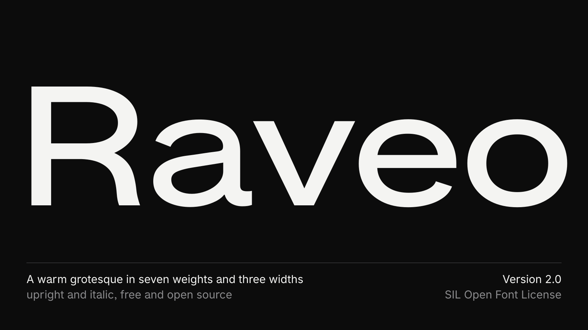
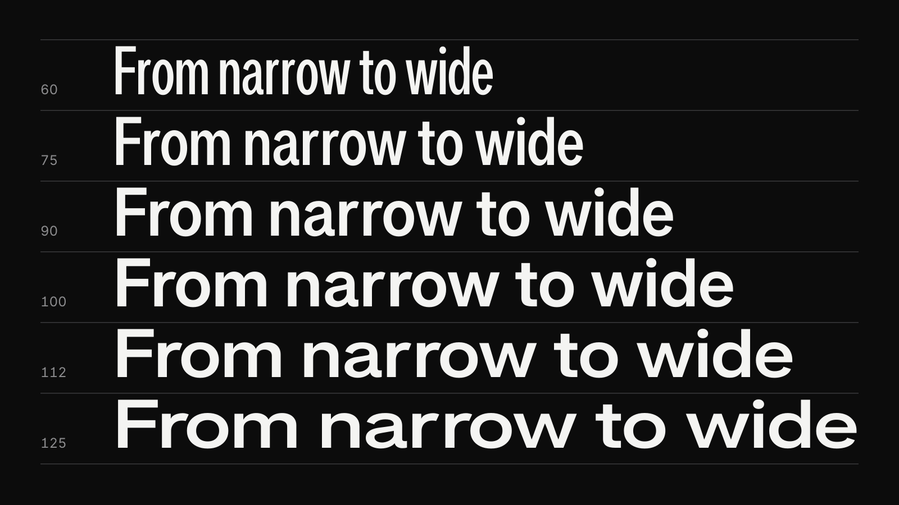
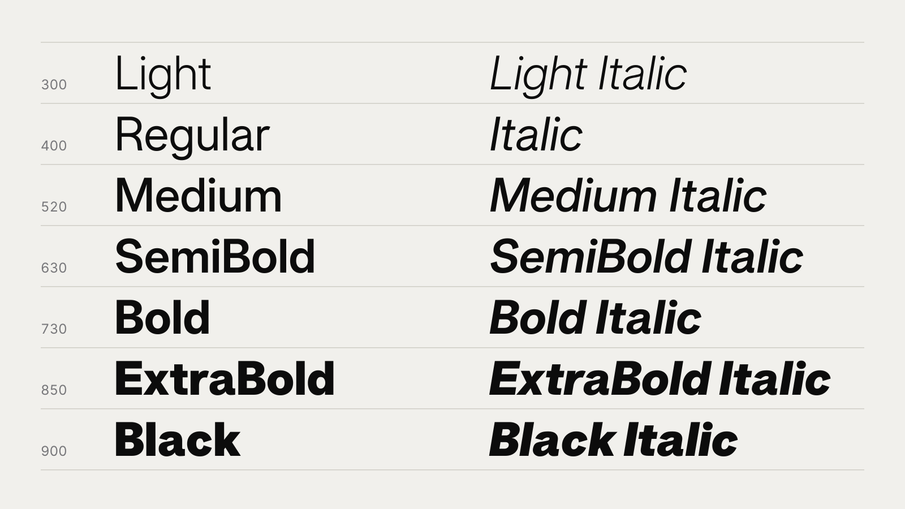
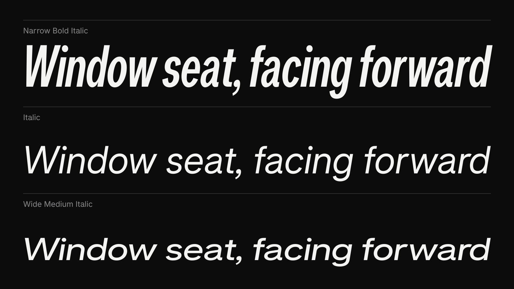
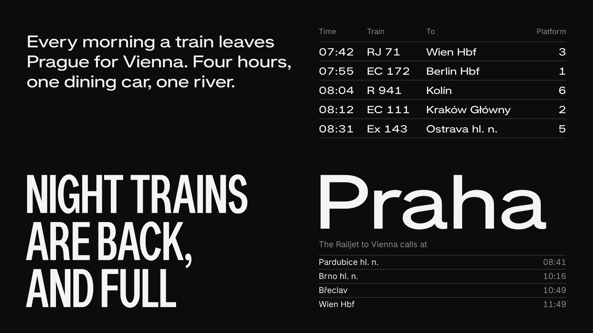
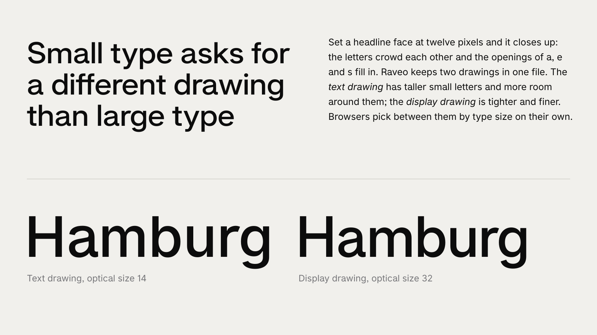
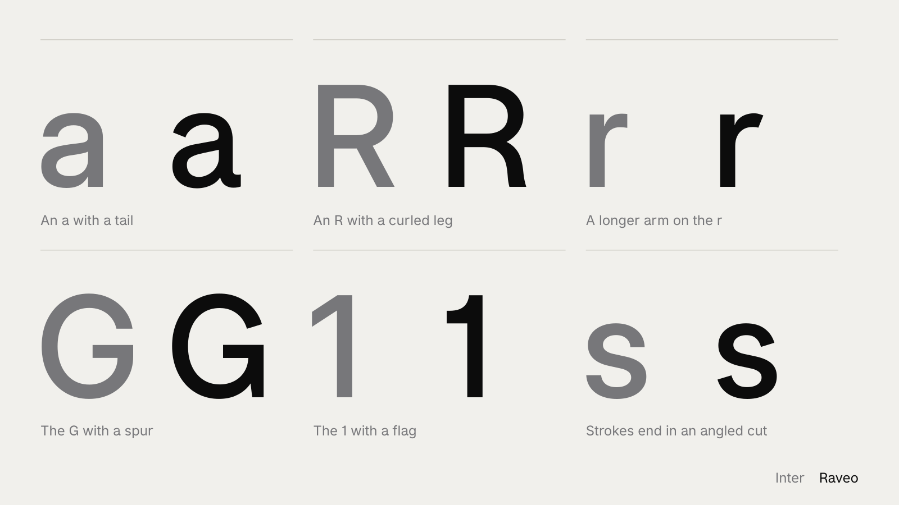
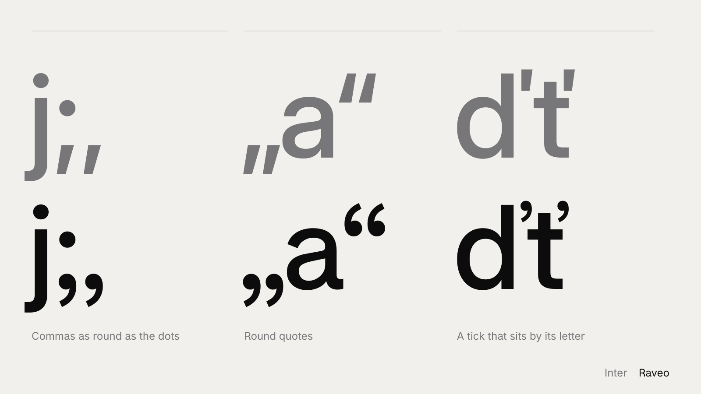

# Raveo



Raveo is a warm grotesque: a variable sans in seven weights and three widths, upright and italic, free
and open source. It began as a fork of [Inter](https://github.com/rsms/inter) with an a that has a tail,
an R with a curled leg and darker named weights. Version 2.0 adds a width axis, an italic for every style
and sharper stroke endings.

[Specimen and tester](https://raveo.jakubfoglar.com) · [Download Raveo 2.0](https://github.com/jakubfoglar/raveo/releases/latest)















## The family

| Axis | Range | Named styles |
| --- | --- | --- |
| Weight `wght` | 300 to 900 | Light 300, Regular 400, Medium 520, SemiBold 630, Bold 730, ExtraBold 850, Black 900 |
| Width `wdth` | 60 to 125 | Narrow 60, regular 100, Wide 125 |
| Optical size `opsz` | 14 to 32 | the text drawing at 14, the Display drawing at 32 |

- **Two variable fonts**, upright and italic, and 84 static styles.
- **Width.** Stems keep their weight while a letter is squeezed or stretched, so the wide Medium is as dark
  as the regular one.
- **Italic.** It leans 9.4 degrees and is Inter's drawn italic with Raveo's letters carried into it; a, e and
  f keep their upright forms. It is a second font file, so `font-style: italic` and the Italic button in
  apps find it.
- **Optical size.** Every letter is drawn twice. Browsers and design apps use the text drawing up to 14
  pixels and the Display drawing from 32 pixels, with a blend in between.
- **Against Inter.** An a with a tail, an R with a curled leg, a longer arm on the r, stroke endings cut at
  an angle, round commas and quotes. The G with a spur and the 1 with a flag are Inter's alternates, made
  the default.
- **Languages.** 826 characters: Latin script for Western, Central and Northern Europe, the Baltics,
  Romanian and Turkish. No Cyrillic, Greek or Vietnamese; for those, use Inter.

## Install

Download the zip from [Releases](https://github.com/jakubfoglar/raveo/releases/latest), or take the files
from [`releases/Raveo-2.0`](releases/Raveo-2.0).

- `desktop/variable/`: `Raveo-VF.ttf` and `Raveo-Italic-VF.ttf`, for Figma, Keynote, Adobe apps and
  browsers. Programs list them as "Raveo Variable".
- `desktop/static/`: one file per named style, for programs without variable-font support (Word,
  PowerPoint). Programs list them as "Raveo".

One set is enough. Remove Raveo 1.1 first: several of its files carry the same names inside.

## On a web page

```html
<link rel="stylesheet" href="https://cdn.jsdelivr.net/gh/jakubfoglar/raveo@v2.0/releases/Raveo-2.0/web/raveo.css">
```

```css
body { font-family: "Raveo", sans-serif; }
h1   { font-weight: 520; font-stretch: 125%; }
.tag { font-weight: 730; font-stretch: 60%; }
em   { font-style: italic; }
```

The stylesheet loads the font in two parts: every European language with punctuation, arrows and common
symbols in the first (about 260 KB), the rare letters in the second. `web/regular-width/` has the same
files without the width axis at about half the size, for pages that never use the narrow and wide styles.

## Upgrading from 1.1

- The weight axis starts at 300. Thin and ExtraLight are gone; weights below 300 show the Light.
- Display styles belong to the family "Raveo" ("Raveo Display Bold"); there is no family "Raveo Display".
- Quotes and commas are round by default.
- Static fonts are TrueType, named `Raveo-<Style>.ttf`; the variable font is `Raveo-VF`, not `RaveoVF`.
- Every character of 1.1 is still there, with the same line height and the same spacing at the regular
  width.

The 1.1 files stay in [`fonts/`](fonts) at their old paths, so pages that link them keep working.

## Building it

Raveo 2.0 is not drawn by hand. A script takes the masters in `sources/` and derives every style from
them: it squeezes and stretches letters while holding their stems, re-cuts stroke endings, respaces and
checks the kerning. Each step is a setting in `recipe.json`.

```sh
python3 -m venv .venv && .venv/bin/pip install -r requirements.txt    # Python 3.12
.venv/bin/python tools/pipeline.py             # the upright variable font, into build/headline/
.venv/bin/python tools/pipeline.py --italic    # the italic
.venv/bin/python tools/release.py 2.0          # everything in releases/Raveo-2.0/, and the zip
.venv/bin/python tools/site_page.py            # the specimen page in site/
```

The sharing image of the page needs `hb-view` (HarfBuzz); everything else comes with the requirements.

### The workbench

```sh
.venv/bin/python tools/serve.py                # http://localhost:4173/workbench/
```

A page for tuning the recipe: every setting is a slider, the letters redraw as it moves, and a draft of
the font is rebuilt in a few seconds. Settings are kept per width (narrowest, regular, widest) and per
optical size; single letters can be adjusted on their own. Save writes `recipe.json`, Export writes a
release.

### Layout

| | |
| --- | --- |
| `sources/` | Raveo's masters (Glyphs format): the upright family and the italic |
| `recipe.json` | the settings a build is made from |
| `tools/` | the pipeline (`pipeline.py`), the release (`release.py`), the page (`site_page.py`), the workbench server (`serve.py`) |
| `workbench/` | the tuning page |
| `site/` | the specimen page |
| `releases/` | finished fonts, one folder per version |
| `fonts/` | Raveo 1.1, as released in 2024 |

`sources/raveo-italic.glyphs` is made by `tools/make_italic.py` from Inter's italic source
([rsms/inter](https://github.com/rsms/inter) at `66647c0`, version 4.1) and needs rebuilding only when
the upright source changes.

## Licence

[SIL Open Font License 1.1](LICENSE.txt): free to use, embed, modify and redistribute, also commercially.
It may not be sold on its own, and modified versions must keep the licence.

"Raveo" is a Reserved Font Name: a modified version needs another name. Subsetting the fonts or
converting them to another format, without changing the letters, is permitted under the name Raveo.

Designed by [Jakub Foglar](https://jakubfoglar.com). Based on Inter by Rasmus Andersson and the Inter
Project Authors. History in [FONTLOG.md](FONTLOG.md).
